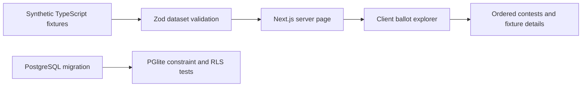

# M1 architecture

## Scope and data flow

The App Router server page loads a synthetic dataset and validates it with Zod. The client explorer receives that dataset, selects an explicit test ballot style, and renders every linked contest in stored ballot order. Search and office-group filters affect the visible list. They do not change the underlying ballot composition or research status. The browser sends no address or political responses to an API.

The fixture adapter and future database adapter share domain models. M2 must add an explicit mapping layer from SQL snake_case rows to domain camelCase records and generate database types from the approved migration. Fixture IDs are human-readable test keys; stored relational identifiers are UUIDs. Fixtures are never loaded into production tables by the seed script.

## Model groups

| Group | Tables and relationships |
| --- | --- |
| Geography | `jurisdictions`, many-to-many `jurisdiction_overlaps`, `districts`, versioned `district_boundaries` |
| Election composition | `elections`, `ballot_styles`, `contests`, `contest_ballot_styles`, `candidates`, `candidate_contest_entries`, `ballot_measures` |
| Questions | `questions`, `question_jurisdictions`, `question_office_types`, immutable `question_versions`, `question_response_options` |
| Method and optional sync | `scoring_method_versions`, `importance_response_options`, `user_sessions`, `user_quiz_responses`, `user_importance_responses` |
| Provenance and import | `source_documents`, `ingestion_runs`, `provenance_records`, `ingestion_diffs` |
| Research | `evidence_records`, `evidence_conflicts`, `research_reviews`, `candidate_positions`, `position_evidence` |
| Publication | `publication_snapshots`, `corrections` |
| Administration | `private.admin_users`, linked to Supabase Auth |

The migration is the SQL source of truth. Zod schemas are application DTO validation, with cross-record ballot checks in `ballotDatasetSchema`. They do not replace database foreign keys. Some publication checks, such as reviewing an entire candidate evidence set, remain M2 server responsibilities.

The separate [evidence review standard](evidence-methodology.md), `evidence-review-v1`, adds a preliminary claim-assessment DTO in `src/domain/research.ts`. It distinguishes actions, statements, insider interpretations, and inferred motives; stores evidence confidence separately from reviewer certainty; and requires references, attribution for insiders, and alternatives/limits for motives. The methodology page renders the shared claim categories and support rubric. The DTO has no intake, SQL persistence, or scorer integration in M1. A later research milestone must enforce evidence resolution and keep insider interpretations and motives out of policy agreement and policy-evidence coverage.

## Integrity decisions

- A contest/style junction repeats `election_id` and uses composite foreign keys to prevent cross-election assignments.
- A contest district must belong to the contest jurisdiction. A city label has no implied county membership. Overlap records support cross-county coverage.
- Contest keys are unique within election and jurisdiction. Person names are not unique identifiers. Official printed names are stored on contest entries, separately from normalized identities.
- A person has at most one entry in a contest. Candidate and contest ordering is unique within its parent. Qualified write-ins retain their entry type. The ordering field is a display sequence; M2 must also preserve official write-in placement rules.
- Measures and candidate entries use discriminator foreign keys, preventing either from attaching to the wrong contest kind.
- Import uniqueness covers source checksum, adapter version, and source record/version keys. M2 must implement transactional reuse/upsert semantics for repeated imports.
- Drafts may be incomplete. Dataset validation rejects missing entries, missing measure text, orphan references, and unassigned contests before serving a completed dataset. SQL allows incomplete staging so a failed parse can be investigated without deleting the contest.
- Evidence and reviewer decisions are immutable. An approved candidate position requires a review for that same candidate and question revision. Supplemental evidence must use matching candidate/question keys. M2 must enforce review of the full evidence set and conflict resolution before scoring.
- Skipped and untouched answers have null policy values and distinct states. Neutral is an answered value of 3. Importance may be null. Response rows carry both user and session ownership, enforced by composite foreign keys and RLS.
- Question and scoring revisions are immutable. Future changes create new revisions. New optional-sync sessions bind a scoring method, and importance options reference that same method.

## Publication and provenance

Every imported entity points to a provenance record, which binds an ingestion run, its source document, exact source record key, and record version. Source records preserve a retrieval timestamp, media type, authority, and SHA-256. `checksum_scope` distinguishes archived document bytes from permitted reference metadata. A metadata checksum makes no claim to hash an inaccessible document.

`publication_snapshots.payload` holds a frozen, versioned denormalized publication artifact. A database trigger computes SHA-256 over UTF-8 bytes of PostgreSQL’s JSONB text representation. Verification must use the same serialization or the database expression, rather than arbitrary JavaScript JSON ordering. The insert guard requires an approved official-source import and resolved required diffs. Snapshots reject updates and deletes, even for normal privileged application writes. Corrections reference the earlier artifact and a replacement.

M1 has no publisher or public data API. The snapshot trigger is a structural guard, not a full payload validator. M2 must validate payload shape, source membership, election identity, complete relationships, reference-ballot comparison, research decisions, and all contributing imports in a trusted publication transaction. A publication may combine multiple source runs inside its payload; `ingestion_run_id` identifies the coordinating run. Record-level provenance must preserve every contributing run.

## Access model

All application tables have RLS. Anonymous visitors have no draft table grants. Authenticated users can access working records only when their UUID exists in `private.admin_users`. Membership can be provisioned only through a trusted database connection. User-editable JWT metadata is never an authorization source. The private membership table permits reading only the caller’s membership and grants no client mutation access.

Anonymous and authenticated clients may read immutable publication snapshots. Neither role can insert, update, or delete snapshots. Future trusted publishing code must run only after authorization and validation, with server secrets isolated from clients. M1 provides no privileged client or publication endpoint.

Reserved opt-in session/response tables permit a user to access only their own rows. Administration status grants no blanket read of other users’ political responses. Those tables remain unused in M1; consent, local storage, export, sync, retention, and deletion UX belong to the quiz milestone.

## Geography boundary

Boundaries are stored as source-versioned WGS84 GeoJSON polygons. M1 validates their envelope and date range only. It performs no geometric validation, point-in-polygon lookup, or eligibility decision. M2 must validate topology and authoritative effective dates, add PostGIS or equivalent indexed spatial queries when needed, and confirm the resulting official ballot style. Coordinates alone are insufficient proof of eligibility.

## Verification limits

PGlite executes the migration and exercises real PostgreSQL constraints, roles, triggers, and policies. The tests bootstrap a minimal Supabase Auth-compatible shim. Full Supabase local reset, Auth/JWT behavior, PostgREST grants, advisors, and hosted configuration require a Docker-backed or isolated Supabase environment before deployment. Nothing in this milestone is a verified official ballot.

## M2 composition mapping and publication controls

The composition workflow now has immutable normalized mapping drafts, append-only mapping reviews, private archive/style evidence, immutable composition publications, an active pointer, and an audit trail. The SQL normalizer reads the stored source import and explicit assignments. Unknown assignments remain blocking issues. Source-occurrence candidate IDs preserve names without claiming global person identity.

The owner-only publisher validates current source reviews, mapping completeness and approval, archive verification, official style evidence, published-baseline review, and expected active pointer in one serialized transaction. Reopened source or mapping reviews withdraw the pointer while retaining the snapshot. Current official drafts are incomplete and unpublished. The fixture explorer and M1 foundation entity tables are unchanged. The M1 generic research snapshot model remains separate from M2 composition publications. See [mapping and publisher workflow](m2-composition-publisher.md) for the implemented boundary and remaining integration work.
